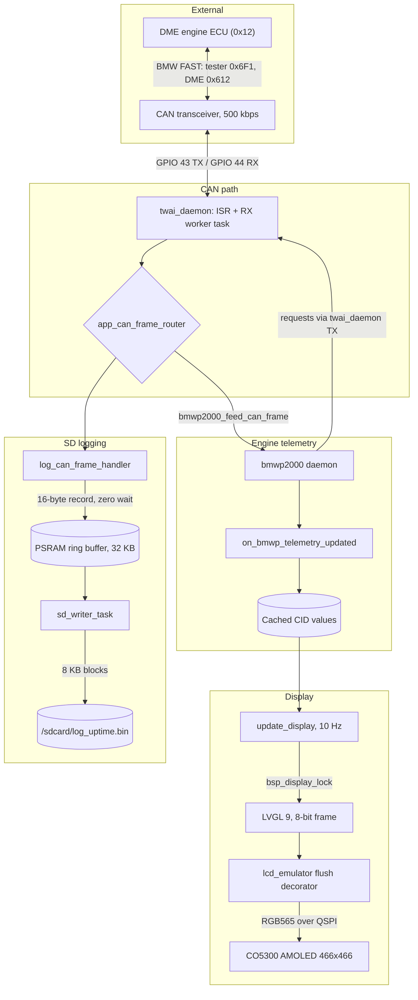
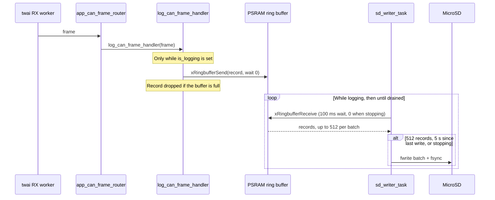
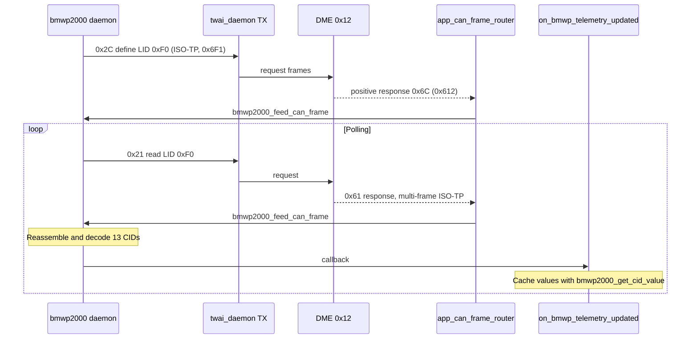
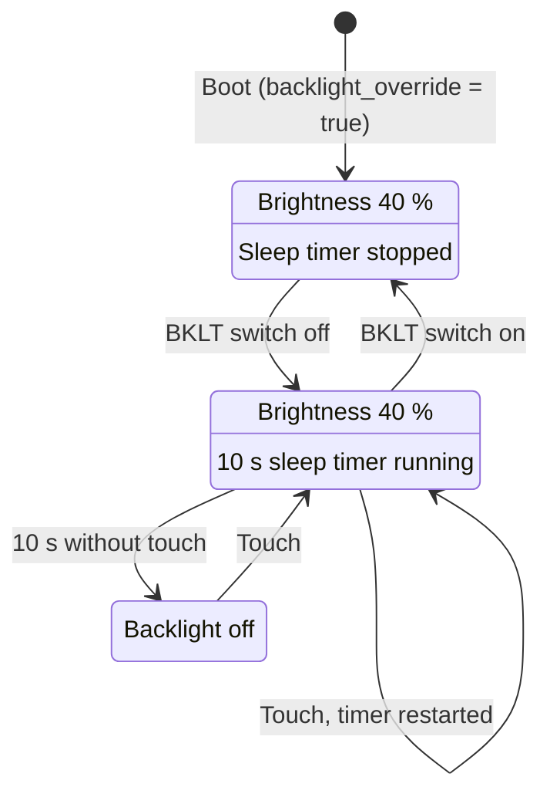

# MiniGauge56 — Theory of Operation (TOO)

## 1. System Overview

MiniGauge56 is a side gauge for the Mini R56 built on the Waveshare ESP32-S3 Touch AMOLED 1.75". One CAN link carries both the diagnostic exchange with the DME and the traffic that is logged to SD. Received frames go through a single router to the SD logger and to the `bmwp2000` KWP2000 engine, which polls engine parameters and hands decoded values to the UI.



---

## 2. Hardware

- **SoC**: ESP32-S3, dual-core Xtensa LX7 at 240 MHz, 16 MB flash, octal PSRAM at 80 MHz (`sdkconfig.defaults`).
- **CAN**: on-chip TWAI controller to an external transceiver, TX on GPIO 43, RX on GPIO 44, 500 kbps.
- **Display**: 466x466 round AMOLED with a CO5300 controller over QSPI and a CST9217 touch controller over I2C, both driven by the `waveshare/esp32_s3_touch_amoled_1_75` BSP.
- **Storage**: MicroSD card mounted at `/sdcard` through the BSP's FATFS driver.

---

## 3. Boot Sequence

`app_main()` in `main/main.cpp` runs these steps in order. A failing step is logged and the next one still runs, except that a display lock failure aborts the UI setup.

1. Create the 10 s one-shot display sleep timer (`slp_disp`).
2. Mount the SD card. On success, allocate the logging ring buffer (`init_can_logging()`).
3. Start TWAI with `initCAN(app_can_frame_router)`.
4. Initialise `bmwp2000`, register `on_bmwp_telemetry_updated()` and start the daemon.
5. Start the display (`bsp_display_start()`), then under the display lock: attach the LCD emulator, build the EEZ UI (`ui_init()`), and set the BKLT and filter switches to match the current state.
6. Wake the display, start the `upd_disp` task, then loop once per second printing debug status (`STATUS`, `BMWP_STATUS` at debug log level).

---

## 4. Tasks

| Task | Created by | Priority | Core | Role |
| :--- | :--- | :--- | :--- | :--- |
| `twai RX worker` (`CAN_RX_Task`) | `twai_daemon` | 5 | `CONFIG_CAN_CORE_AFFINITY` (default 1) | Takes frames from the RX queue and calls the router |
| `bmwp2000` daemon | `bmwp2000` | see component | see component | KWP2000 / ISO-TP state machine, polling, decoding |
| `sd_writer` | `start_logging()` | 5 | unpinned | Drains the ring buffer to SD; exits when a session ends |
| `upd_disp` | `app_main()` | 3 | unpinned | Refreshes the active UI page every 100 ms |
| LVGL task | BSP (`esp_lvgl_adapter`) | see BSP | see BSP | Renders and flushes; the LCD emulator runs inside its flush callback |
| `slp_disp` | FreeRTOS timer service | timer task | | Turns the backlight off after 10 s without touch when always-on is off |

---

## 5. CAN Path

### 5.1 Reception and routing
`twai_daemon` receives frames in its `on_rx_done` ISR, queues them (32-entry RX queue) and its RX worker calls `app_can_frame_router()` for each one. The router calls the SD logger handler first and then `bmwp2000_feed_can_frame()`. With `CONFIG_CAN_ENABLE_LOOPBACK=y`, frames the gauge transmits are received too, so an SD log contains both the requests and the DME's responses.

### 5.2 SD logging



**Record format** (16 bytes, packed, little-endian): uptime in ms (`uint32`), CAN ID (`uint16`), DLC (`uint8`), 8 data bytes (zero padded), 1 padding byte. Only the low 16 bits of the ID are kept.

**Session lifecycle**:
- `start_logging()` runs only when no session is active and the previous writer has exited. It empties stale records from the ring buffer, sets `is_logging` and creates `sd_writer`.
- `sd_writer` opens `/sdcard/log_<esp_timer_us>.bin` unbuffered and allocates an 8 KB DMA-capable batch buffer. If either fails, it clears `is_logging` and exits; the UI then reverts the LOG switch.
- `stop_logging()` clears `is_logging`. The writer keeps draining without waiting, writes the last partial batch, closes the file and exits.
- `current_file_size` and `current_buffered_bytes` feed the logger page.

`start_logging_test()` runs the same writer with a synthetic 500 Hz frame generator for throughput tests; nothing calls it in the current firmware.

---

## 6. Engine Telemetry (BMWP2000)

`bmwp2000` implements KWP2000 (ISO 14230-3) over ISO-TP (ISO 15765-2) with BMW FAST addressing: the tester sends on CAN ID `0x6F1`, the DME (address `0x12`) answers on `0x612`. Its parameter dictionary and LID layout are the project files set in `sdkconfig.defaults`:

- `CONFIG_BMWP2000_CUSTOM_CIDS_PATH="config/cids.json"`: the CID dictionary (ECU identifier, size, position, sign and `((raw * mul) / div) + add` scaling for each named parameter).
- `CONFIG_BMWP2000_CUSTOM_LIDS_PATH="config/lids.json"`: the LID trains to define on the ECU.

The project defines one LID, `0xF0` "engineCore", in `single` transmission mode: the daemon defines the LID on the DME with `dynamicallyDefineLocalIdentifier` (`0x2C`), then polls it with `readDataByLocalIdentifier` (`0x21`) and decodes the 13 CIDs from each response.



The daemon reports its state through `bmwp2000_get_state()`. The UI shows these states on the BMWP2000 page:

| State | Label | LCD palette |
| :--- | :--- | :--- |
| `BMWP2000_STATE_UNINIT` | UNINIT | alternate |
| `BMWP2000_STATE_BACKOFF_WAIT` | WAIT | primary |
| `BMWP2000_STATE_SETUP_LID` | SETUP | primary |
| `BMWP2000_STATE_CLEAR_LID` | CLEARING | alternate |
| `BMWP2000_STATE_READ_REQ` | REQUEST | primary |
| `BMWP2000_STATE_RESPONSE_PENDING` | PENDING | primary |
| `BMWP2000_STATE_TX_WAIT_FC` | WAIT FC | primary |
| `BMWP2000_STATE_RX_WAIT_CF` | WAIT CF | primary |
| `BMWP2000_STATE_RUNNING` | RUNNING | primary |

Retry, back-off and task details belong to the component; see the [BMWP2000 repository](https://github.com/martinroger/BMWP2000).

The cached values are plain `double`s written in the daemon's callback and read by `upd_disp` without a lock. A 64-bit store is not atomic on the 32-bit core, so a read can occasionally see a torn value, and one refresh can mix values from two consecutive responses.

---

## 7. Display

### 7.1 Pages
The UI is a single LVGL tabview (`objects.global_tabview`) generated by EEZ Studio from `eezMG56.eez-project`. The tab bar is hidden (size 0) and pages are changed by swiping. `update_display()` reads the active page every 100 ms, takes `bsp_display_lock(100)` and updates only that page; a lock timeout skips the cycle.

| Index | Tab name | Content | Updated widgets |
| :--- | :--- | :--- | :--- |
| 0 | `engine_temp` | Coolant temperature, large readout, arc | `engine_temp` (`engineTemp`) |
| 1 | `oil_temp` | Oil temperature, large readout, arc | `oil_temp` (`oilTemp`) |
| 2 | `bm_daemon` | Update count, RPM, oil and coolant temperature, HPFP, daemon state | `bmw_frames_count`, `bmw_rpm`, `bmw_oil_temp`, `bmw_engine_temp`, `bmw_hpfp`, `bmw_state` |
| 3 | `logger` | File size, status, BKLT and LOG switches | updated on every cycle, whatever page is active |
| 4 | `widget test` | Filter switch | event-driven only |

On every cycle, whatever page is shown, `update_display()` also writes the logger page's size and LOGGING / PAUSED labels and unchecks the LOG switch if the writer has stopped by itself. The arcs on pages 0 and 1 are not driven yet.

Fonts: League Gothic at 42, 48, 96, 120 and 192 px and Teko at 36 px (`components/ui/src/ui_font_*.c`; sources in `ui_reference/fonts`).

### 7.2 Retro LCD emulation
`lcd_emulator_init()` wraps the display's flush callback. LVGL renders an 8-bit (L8) frame (`CONFIG_LV_COLOR_DEPTH_8`); the decorator turns each flushed tile into a dot-matrix image (3 px cells, 8-bit grayscale shading) and expands it to RGB565 for the panel. Two palettes are configured: a custom amber primary palette and a red-amber alternate, switched by the BMWP2000 state. The widget test page switch turns emulation off and on at runtime. Details: [LCD emulator TOO](../components/lcd_emulator/TOO.MD) and [HOWTO](../components/lcd_emulator/HOWTO.md).

### 7.3 Power management



Every widget forwards `LV_EVENT_PRESSED` to `action_global_pressed()`, which calls `wakeDisplay()`. `wakeDisplay()` sets 40 % brightness under the display lock (500 ms timeout, because the first frame at boot can hold the lock longer than 100 ms) and restarts or stops the sleep timer depending on `backlight_override`. When the display is asleep, a touch on the LOG switch only wakes it and does not change logging.

---

## 8. Build and CI

### 8.1 Local build
ESP-IDF v6.1, target `esp32s3`. The project can be built through Espressif's MCP server, registered in [.mcp.json](../.mcp.json):

```
eim run "idf.py mcp-server" v6.1
```

| Step | Action | Expected result |
| :--- | :--- | :--- |
| 1 | Start the agent from the repository root and approve the project-scoped `esp-idf-eim` server | The server shows as connected |
| 2 | Read resource `project://status` | Reports IDF v6.1, target and build dir |
| 3 | `set_target` (esp32s3) when initialising, then `clean_project` | Fresh CMake cache |
| 4 | `build_project` | `build/` populated; read the full log on failure |
| 5 | `flash_project` (port from `project://devices`) | Only on explicit request |

Without MCP: `eim run "idf.py fullclean build" v6.1`. Constraints: [CONSTRAINTS.md](CONSTRAINTS.md).

### 8.2 CI
[.github/workflows/build.yml](../.github/workflows/build.yml) runs on pull requests and pushes to `main`, inside the `espressif/idf:v6.1` container:

1. Check out the repository.
2. Point git at GitHub with the `PRIVATE_REPOS_TOKEN` secret so the component manager can clone the private `bmwp2000` repository.
3. Restore the component manager cache (keyed on `main/idf_component.yml` and `dependencies.lock`) and the ccache directory.
4. `idf.py build`, then print ccache statistics.
5. Upload the application, bootloader and partition table binaries plus `dependencies.lock` as the `firmware` artifact.

The component cache is effective. ccache restores but currently gets no hits between runs, so the build itself is not yet faster on warm runs.
